## Part 1. Настройка gitlab-runner  

Подними виртуальную машину Ubuntu Server 24.04 LTS.  
Будь готов, что в конце проекта нужно будет сохранить дамп образа виртуальной машины.  

Скачай и установи на виртуальную машину gitlab-runner.  

Запусти gitlab-runner и зарегистрируй его для использования в текущем проекте (DO6_CICD).  

Для регистрации понадобятся URL и токен, которые можно получить на страничке задания на платформе.  

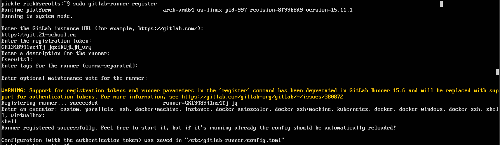  
Регистрация gitlab-runner

## Part 2. Сборка  

Напиши этап для CI по сборке приложений из проекта SimpleBashUtils.  

В файле .gitlab-ci.yml добавь этап запуска сборки через мейк файл из проекта SimpleBashUtils.  

Файлы, полученные после сборки (артефакты), сохрани в произвольную директорию со сроком хранения 30 дней.  

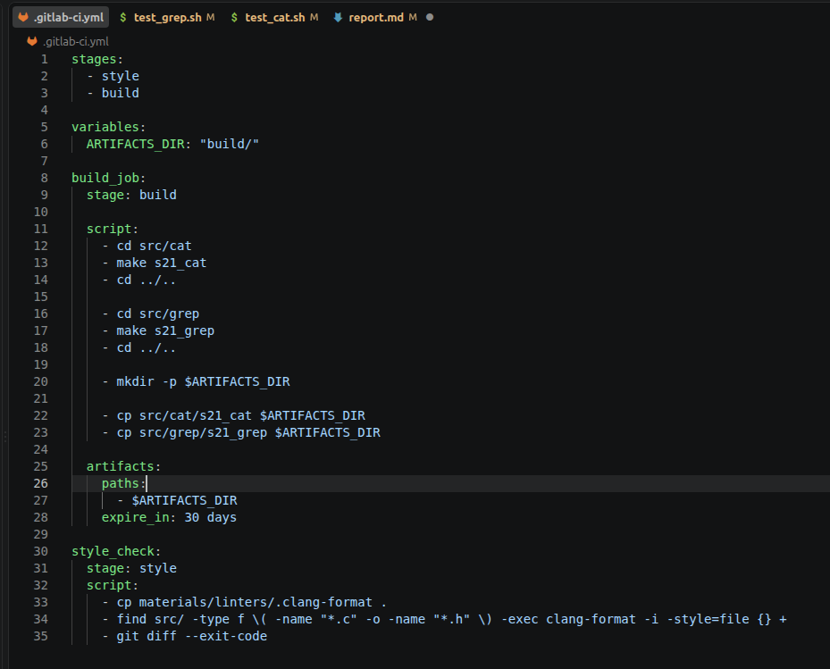  
Содержимое .gitlab-ci.yml  

Поскольку я использую shell executor, пакеты нужно установить на саму виртуальную машину один раз через sudo. Подключаюсь к VM1 по SSH и выполняю:  
```
sudo apt update
sudo apt install -y make gcc clang-format
```

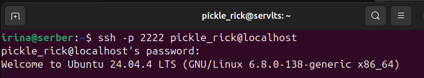  
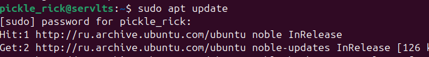  
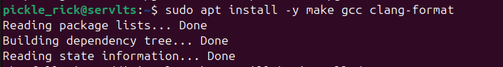  

Затем пушу изменения в гитлаб и перехожу в гитлабе через левое меню в Pipelines, где можно ознакомится с результатами прохождения пайплайна:  
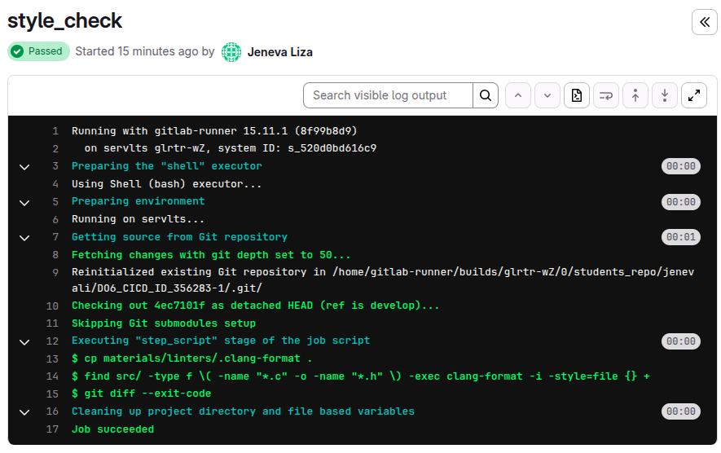  
style_check  
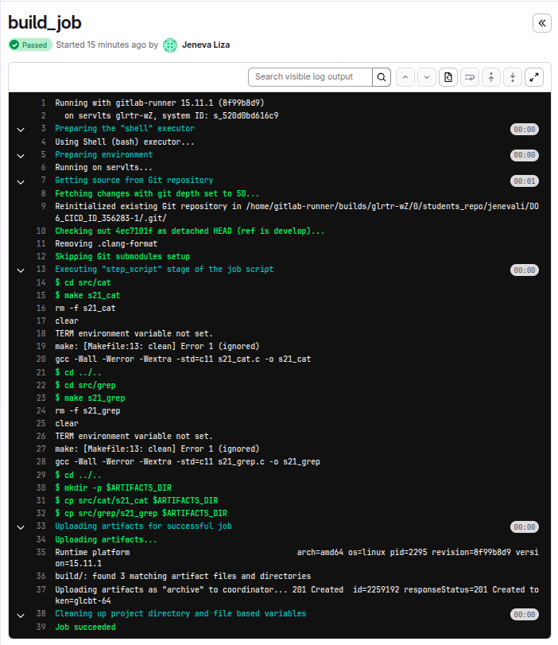  
build_job  


## Part 4. Интеграционные тесты  

Напиши этап для CI, который запустит интеграционные тесты.

Для проекта SimpleBashUtils можешь взять свои уже написанные интеграционные тесты.

Запусти этот этап автоматически только при условии, если сборка и тест кодстайла прошли успешно.

Если тесты не прошли, то «зафейли» пайплайн.

В пайплайне отобрази вывод, что интеграционные тесты успешно прошли / провалились.

Мои тесты в конце просто печатают статистику ($FAIL, $LEAK), но не возвращают ненулевой код возврата при провале. Это значит, что GitLab будет считать задание успешным, даже если тесты упали. исправляю это:  

```
if [ "$FAIL" -ne 0 ] || [ "$LEAK" -ne 0 ]; then
    exit 1
fi
exit 0
```

Valgrind для проверки утечек должен быть установлен на VM, где работает раннер (shell executor):  

```
sudo apt install -y valgrind
```  

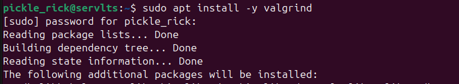  
Установка валгринд  

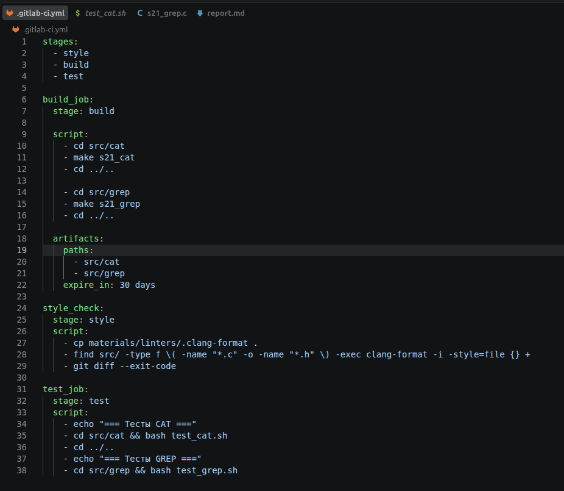  
Содержимое .gitlab-ci.yml  

Для тестов немного меняю содержимое файла .gitlab-ci.yml, теперь артифакты хранятся в своих же папках cat & grep

Если test_cat.sh завершится с ненулевым кодом, задание упадёт сразу.  

Если он вернёт 0 — выполнится test_grep.sh.  

GitLab автоматически зафейлит задание при любом ненулевом коде.  

Пушим изменения и проверяем отчёт пайплайна:  

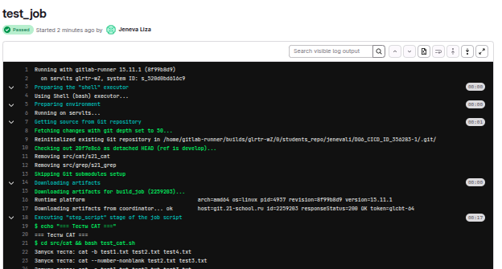  
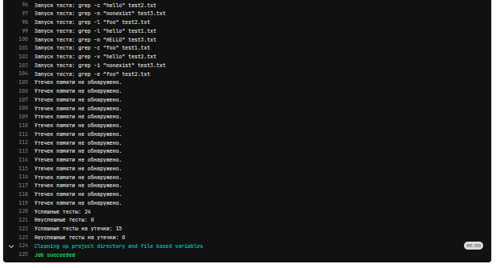  
test_job  

## Part 5. Этап деплоя  

Подними вторую виртуальную машину Ubuntu Server 24.04 LTS.  
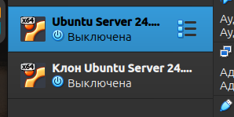  
Клон первой машины

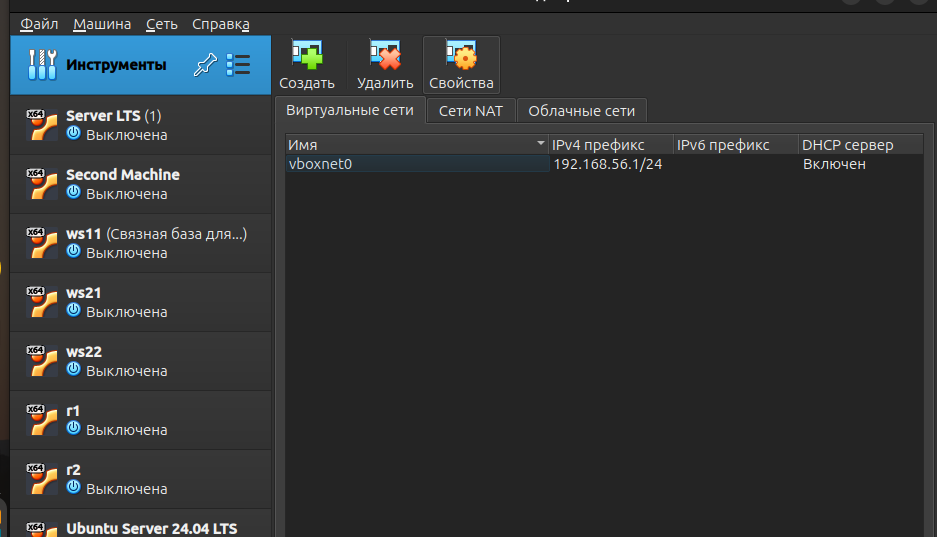  
Через инструменты добавляю виртуальную сеть  

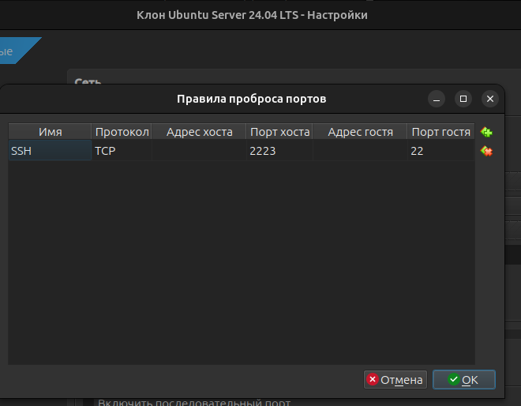  
В NAT для второй машины как и для первой пробрасываю порты, чтобы подключаться к машине через терминал хоста  

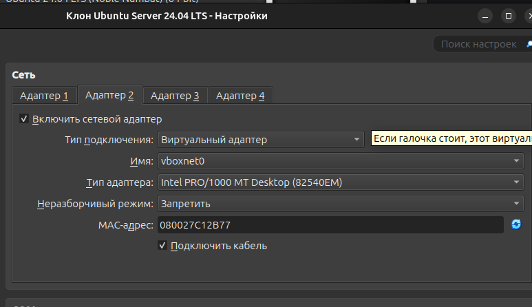  
На двух машинах добавляю адаптер виртуальный адаптер  

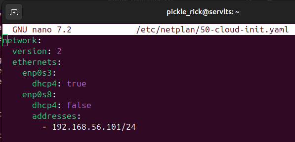  
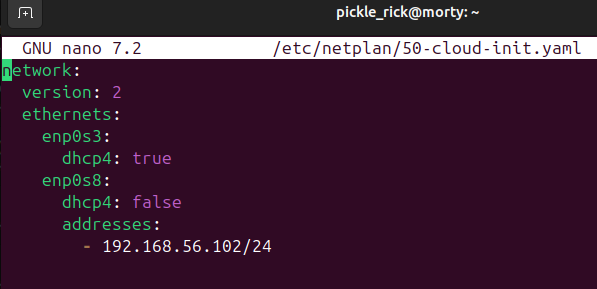  
Статически прописываю адреса  

Применяю нетплан и пингую машины и интернет  
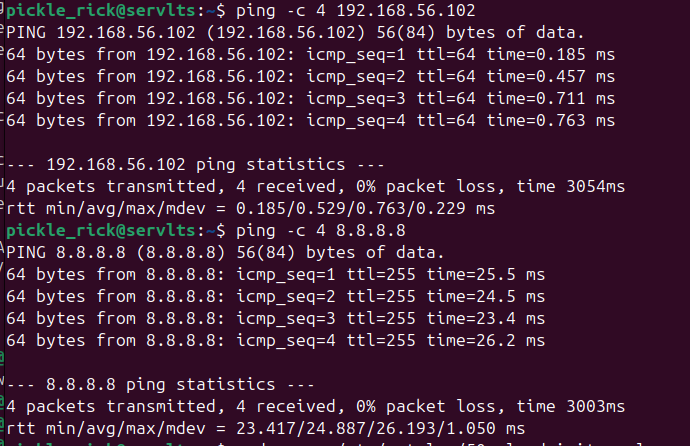  
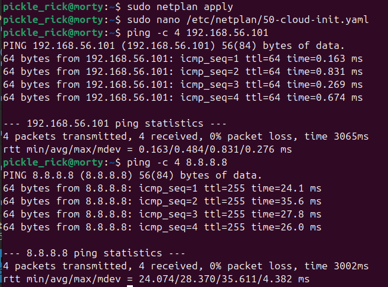  
Результаты пингов  

Напиши этап для CD, который «разворачивает» проект на другой виртуальной машине.  

Поскольку вторая машина клонирована ssh сервер на ней должен быть, но проверяю:  
```
sudo systemctl status ssh
```  

Генерирую ключ для gitlab-runner на VM1:  
```
sudo -u gitlab-runner ssh-keygen -t rsa -b 4096 -f /home/gitlab-runner/.ssh/id_rsa -N ""
```  

Копирую публичный ключ:  
```
sudo cat /home/gitlab-runner/.ssh/id_rsa.pub
```  

Добавляю ключ на VM2
```
mkdir -p ~/.ssh
chmod 700 ~/.ssh
echo "ПУБЛИЧНЫЙ_КЛЮЧ" >> ~/.ssh/authorized_keys
chmod 600 ~/.ssh/authorized_keys
```  

Проверяю SSH с VM1:  
```
sudo -u gitlab-runner ssh -o StrictHostKeyChecking=accept-new pickle_rick@192.168.56.102 "echo OK"
```  

Настраиваю passwordless sudo на VM2, чтобы не вводить пароль:  
```
echo "pickle_rick ALL=(ALL) NOPASSWD:ALL" | sudo tee /etc/sudoers.d/ubuntu-deploy
sudo chmod 440 /etc/sudoers.d/ubuntu-deploy
```  
И проверяю с VM1:  
```
sudo -u gitlab-runner ssh ubuntu@192.168.56.102 "sudo whoami"
# должно вывести: root
```  

Запусти этот этап вручную при условии, что все предыдущие этапы прошли успешно.  

Напиши bash-скрипт, который при помощи ssh и scp копирует файлы, полученные после сборки (артефакты), в директорию /usr/local/bin второй виртуальной машины.  

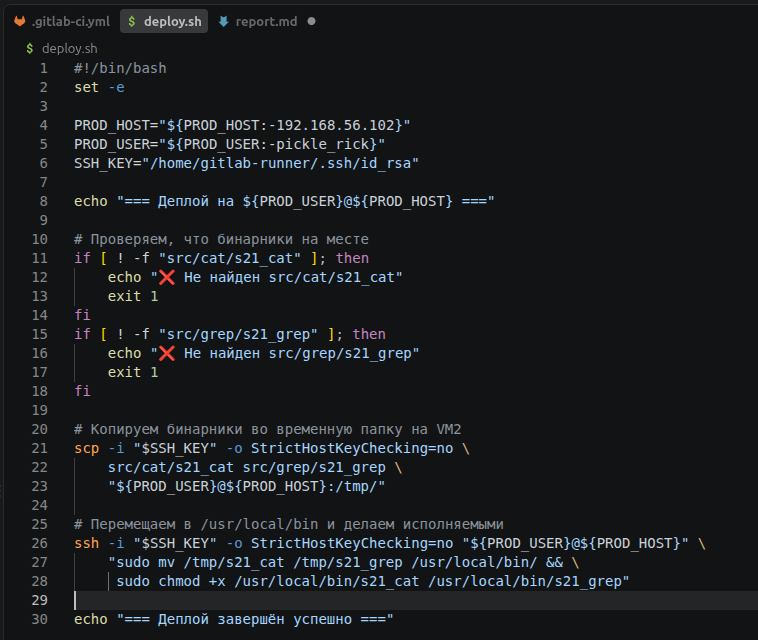  
Деплой скрипт  

В файле .gitlab-ci.yml добавь этап запуска написанного скрипта.  
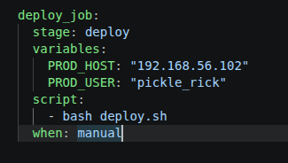  


В случае ошибки «зафейли» пайплайн.  
В результате ты должен получить готовое к работе приложения из проекта SimpleBashUtils (cat и grep).  
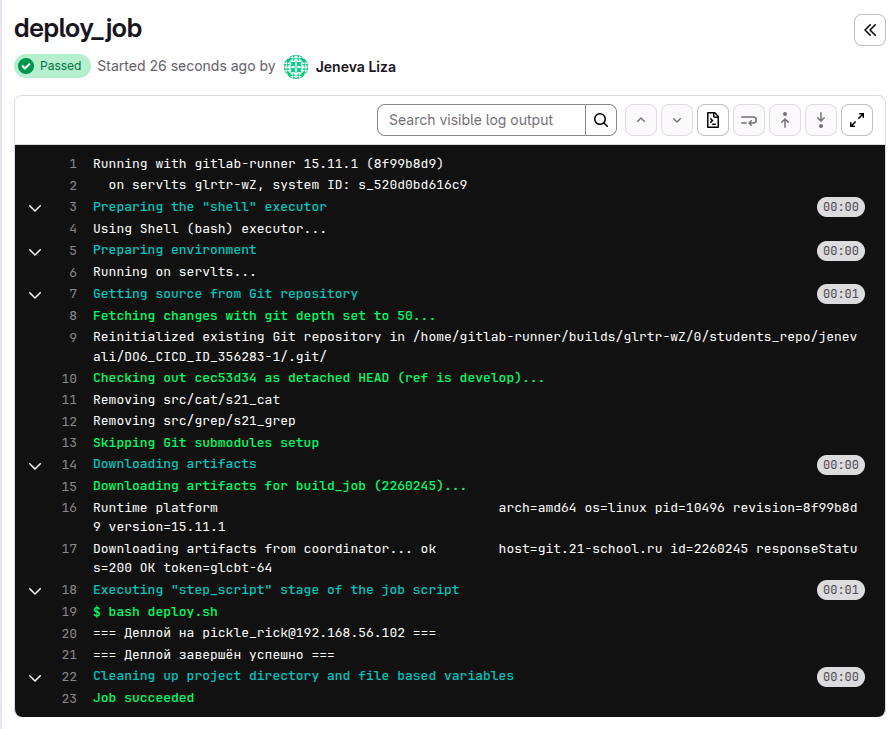  
Результат деплоя  

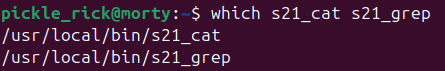  
Бинарники на месте  
